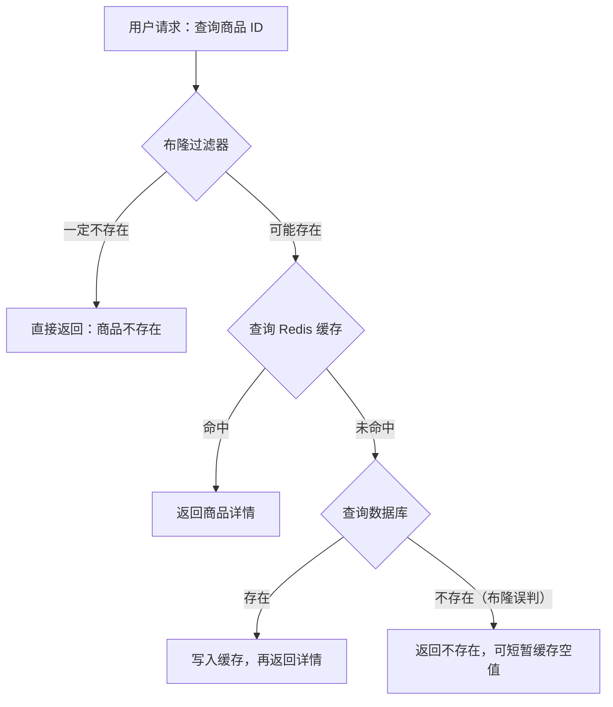

# 1. 简介

很多业务中都会遇到这样一类问题：**判断一个元素是否在一个超大集合中**。例如：

- 缓存穿透防护：请求的 ID 在数据库中根本不存在，如何避免每次都打到数据库？
- 爬虫 URL 去重：几十亿个 URL，如何快速判断是否已经爬过？
- 推荐系统去重：给用户推荐内容时，如何过滤掉已经看过的内容？
- 垃圾邮件、恶意 IP 过滤、用户名是否已被注册等。

最直接的做法是用 `HashSet` 或 Redis 的 `SET`。但当数据量达到亿级时，内存开销会变得非常大。以 1 亿个平均长度 32 字节的字符串为例，仅原始数据就需要约 3GB，加上 Redis 的对象和数据结构开销，实际内存往往还要翻几倍。

**布隆过滤器（Bloom Filter）**就是为这类场景设计的数据结构。它以**极小的内存**和**可控的误判率**，实现高效的成员存在性判断。

布隆过滤器是一种**用很少的内存，快速判断某个元素是否存在**的数据结构，底层通常由位数组和多个哈希函数组成。它的特点是：**判断“不存在”就一定不存在，判断“存在”则可能误判**，所以常被用作正式查询前的一道筛选。它是一种通用算法，除了 Redis，在 RocksDB、 Cassandra 中也会用到。

# 2. 使用场景

在 Redis 中，布隆过滤器主要用来解决**缓存穿透**：请求查询不存在的商品时，缓存始终无法命中，大量请求会直接访问数据库。

一个实际使用场景流程如下：

1. 请求先经过布隆过滤器，如果不存在则直接返回，省去缓存和数据库查询，可能存在，再查询缓存；
2. 查询 Redis 缓存，缓存命中时，直接返回商品详情，缓存未命中，再查询数据库；
3. 查询数据库，存在时返回顺便写入缓存，不存在时存在布隆误判，克短暂缓存空值；



关键点：

- **数据新增时必须同步写入过滤器**，否则新数据会被误判为"不存在"而无法访问；
- 布隆过滤器有误判，少量不存在的请求仍会到达数据库，**应配合"缓存空值"作为兜底**；
- 数据删除后，过滤器中的对应位无法清除。这只会略微提高误判率，不会影响正确性。

# 3. 基本原理

**数据结构**

布隆过滤器由两部分组成：

1. 一个长度为 **m** 的**位数组（bit array）**，初始时所有位都为 0；
2. **k** 个相互独立的**哈希函数**，每个函数把输入映射到 `[0, m-1]` 范围内的一个位置。

**添加元素**

添加元素时，用 k 个哈希函数分别计算出 k 个位置，并把这些位置都置为 1。


**查询元素**

查询元素时，用同样 k 个哈希函数计算出 k 个位置：

- 只要**有任意一位为 0**，则 y **一定不存在**；
- 如果**所有位都为 1**，则 y **可能存在**。


布隆过滤器非常节省空间，但是存在一定误判，越省空间误判率越高。

| 误判率 p | 每元素所需 bit | 最优哈希函数个数 k | 1 亿元素所需内存 |
| -------- | -------------- | ------------------ | ---------------- |
| 10%      | 4.79           | 3                  | ≈ 57 MB          |
| 1%       | 9.59           | 7                  | ≈ 114 MB         |
| 0.1%     | 14.38          | 10                 | ≈ 171 MB         |
| 0.01%    | 19.17          | 13                 | ≈ 228 MB         |

# 4. 使用方式

Redis 本身的核心数据结构里没有布隆过滤器，常见的实现方式有三种：

1. **RedisBloom 模块**（官方推荐，Redis Stack 自带，Redis 8 起已集成进 Redis 开源版）；
2. **基于 Bitmap 自行实现**；
3. **客户端框架封装**，如 Java 的 Redisson。

## 4.1 RedisBloom

推荐使用 Redis Stack，包含 RedisBloom 在内的多个官方模块，或者单独加载 RedisBloom 模块，也可以使用Redis 8 及以上版本，已整合内置布隆过滤器，无需额外安装。

### 4.1.1 指令

**BF.RESERVE 创建过滤器**

```redis
BF.RESERVE key error_rate capacity [EXPANSION expansion] [NONSCALING]
```

- `error_rate`：期望误判率，例如 0.01 表示 1%；
- `capacity`：预期容纳的元素数量；
- `EXPANSION`：容量用尽后，新建子过滤器的容量倍数，默认为 2；
- `NONSCALING`：禁止自动扩容，元素数量达到容量后再添加会报错。

如果不显式创建，直接调用 `BF.ADD` 也会自动创建过滤器，但会使用默认参数（误判率 0.01、容量 100）。默认容量很小，会导致频繁扩容，**生产环境强烈建议先用 `BF.RESERVE` 显式创建**。

**BF.ADD / BF.MADD 添加元素**

```redis
BF.ADD key item
BF.MADD key item1 item2 item3
```

**BF.EXISTS / BF.MEXISTS 查询元素**

```redis
BF.EXISTS key item
BF.MEXISTS key item1 item2
```

**BF.INSERT 创建并添加**

```redis
BF.INSERT key [CAPACITY capacity] [ERROR error] [EXPANSION expansion]
          [NOCREATE] [NONSCALING] ITEMS item [item ...]
```

`NOCREATE` 表示过滤器不存在时报错而不是自动创建，可以防止参数被意外地设为默认值。

**BF.INFO 查看过滤器信息**

```redis
BF.INFO key
```

**BF.CARD 获取已添加元素数量**

```redis
BF.CARD key
```

**BF.SCANDUMP / BF.LOADCHUNK 备份与迁移**

```redis
BF.SCANDUMP key iterator
```

指定迭代位置 iterator，首次传 0，后续传上一次返回的迭代值。

返回两个值，iterator 是下一次调用使用的迭代值，0 表示导出完成，data 是本次导出的二进制数据块。

```redis
BF.LOADCHUNK key iterator data
```

key 是要恢复到的目标过滤器名称，可以与源名称不同，iterator 传 `BF.SCANDUMP` 返回的迭代值，data 则是导出命令返回的数据块。

### 4.1.2 实现原理

**数据结构**

RedisBloom 采用的是**可扩展布隆过滤器（Scalable Bloom Filter，SBF）**。


- 初始只有一个子过滤器 BF_0，容量为 `capacity`；
- 当 BF_0 中的元素数达到容量后，新建子过滤器 BF_1，容量为上一层的 `EXPANSION` 倍；
- **新元素只写入最新的子过滤器**；
- **查询时需要依次检查所有子过滤器**，任意一个命中即返回"可能存在"。

多个子过滤器串联时，总误判率近似为各层误判率之和，如果每层误判率都相同，层数越多，总误判率就越高。因此 RedisBloom 让每新增一层，误判率按比例收紧（收紧系数为 0.5）。

扩容的代价：

- **查询变慢**：层数越多，单次查询需要检查的位越多；
- **内存增加**：后续层误判率更低，单个元素占用的位更多。

因此**预估好容量、减少扩容次数**是使用 RedisBloom 的重要原则。如果业务规模确定，也可以使用 `NONSCALING` 关闭扩容。关闭扩容后不需要预留多层结构，内存利用也会稍微高一些。

**哈希策略**

计算 k 个完全独立的哈希函数代价较高。RedisBloom 使用 **Kirsch-Mitzenmacher 优化（双重哈希）**，只计算两个哈希值，用 `哈希值1 + k * 哈希值2`，就能模拟出 k 个哈希函数，这种方式在渐近意义上不会提高误判率。

RedisBloom 底层使用 **MurmurHash64A** 计算基础哈希值。它速度快、分布均匀，是非加密哈希中的常用选择。

伪代码如下：

```c
uint64_t h1 = MurmurHash64A(item, len, SEED);
uint64_t h2 = MurmurHash64A(item, len, h1);

for (int i = 0; i < k; i++) {
    uint64_t pos = (h1 + i * h2) % bits;
    if (mode == ADD)   set_bit(bitarray, pos);
    if (mode == CHECK && !get_bit(bitarray, pos)) return NOT_FOUND;
}
```

## 4.2 基于 Bitmap 自行实现

如果环境不允许安装模块，例如使用的是不支持 RedisBloom 的旧版云 Redis，可以用 Redis 原生的 `SETBIT` 和 `GETBIT` 自行实现。

1. 根据 n 和 p 计算 m 和 k；
2. 对元素做哈希，用双重哈希生成 k 个位置；
3. 添加时用 Pipeline 批量执行 `SETBIT`，查询时批量执行 `GETBIT`，使用 Lua 脚本保证原子性。

## 4.3 Redisson

Redisson 提供了开箱即用的分布式布隆过滤器。它的底层同样基于 Bitmap，**不依赖 RedisBloom 模块**。

```java
Config config = new Config();
config.useSingleServer().setAddress("redis://127.0.0.1:6379");
RedissonClient redisson = Redisson.create(config);

RBloomFilter<String> bloomFilter = redisson.getBloomFilter("order:filter");
// 预期 1000 万元素，误判率 0.1%
bloomFilter.tryInit(10_000_000L, 0.001);

bloomFilter.add("order_10001");
boolean exists = bloomFilter.contains("order_10001"); // true
long count = bloomFilter.count();                     // 估算元素数量
```

- `tryInit` 会计算 m 和 k，并把配置保存到一个名为 `{filterName}:config` 的 Hash 中，便于多个客户端共享同一套参数；
- 位数组存储在名为 `{filterName}` 的 Bitmap 中；
- 内部使用 HighwayHash 生成哈希值，并通过 Pipeline 或批量命令执行 `SETBIT` 和 `GETBIT`；
- 不支持自动扩容，元素超出预期后误判率会持续升高。

## 4.4 方式对比

| 维度     | RedisBloom                  | Bitmap 自实现         | Redisson            |
| -------- | --------------------------- | --------------------- | ------------------- |
| 依赖     | 需加载模块（Redis 8+ 内置） | 无                    | 仅需客户端依赖      |
| 自动扩容 | ✅ 支持                      | ❌                     | ❌                   |
| 性能     | 高（服务端单命令完成）      | 中（Pipeline 多命令） | 中                  |
| 网络开销 | 小                          | 较大                  | 较大                |
| 跨语言   | ✅ 任意语言                  | 需各语言保持算法一致  | 仅限 Java           |
| 规模上限 | 受实例内存限制              | 单 key 512MB          | 单 key 512MB        |
| 推荐场景 | **首选**                    | 无法装模块时          | Java 技术栈快速接入 |

# 5. 注意事项

**合理预估容量**

- 容量**设小了**：触发频繁扩容（RedisBloom），或者误判率失控（Bitmap 方案）；
- 容量**设大了**：浪费内存；

建议按照"当前数据量 × 未来 1～2 年的增长系数"来设定；

**不支持删除**

标准布隆过滤器不支持删除。如果业务确实需要删除元素，可以考虑以下方案：

1. **定期重建**：创建新过滤器，从数据源全量加载，然后通过 `RENAME` 原子切换；
2. **使用布谷鸟过滤器（Cuckoo Filter）**：RedisBloom 同样提供了这种结构，支持删除，查找性能可能更好，但是它对同一元素插入过多次会导致插入失败，高负载下插入性能不稳定；
3. **计数布隆过滤器（Counting Bloom Filter）**：把每一位扩展成计数器，代价是内存翻几倍；

**大 key 与集群**

亿级数据的过滤器可能达到数百 MB。执行 `DEL` 时应使用 `UNLINK` 异步删除，避免阻塞；

在集群模式下，单个过滤器会集中在一个分片上。数据量特别大时，可以按业务维度或哈希取模拆分成多个过滤器，例如 `bf:product:{0..15}`；

